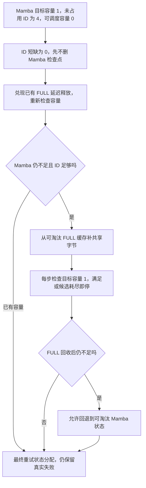

# 为 Mamba 申请一个状态，为什么回收的却可能是 FULL 缓存

源码版本：`0f6761b54facebb47f2068f87ecccd8f14da3a0e`。证据等级：静态源码核对。沿用 FULL+MAMBA、Python 树核、page=1、双端共享字节池与 lazy compaction，关闭 SWA、HiCache、PD、ReplaySSM、推测、会话及分布式。图与 b、2b 比例为教学容量模型，未运行回收或测量延迟；未跟踪导读不作为提交证据。

沿用上一例：Mamba 尚有四个未占用 ID，但共享间隙 b 不足以容纳一个成本为 2b 的状态，当前可调度容量为零。B 需要一个新的活动或跟踪槽。如果看到 alloc(1) 失败就立刻删除一个 Mamba 检查点，可能丢掉很有价值的恢复位置；如果只删除 FULL 又不检查 Mamba ID 是否用尽，也可能回收很多字节却仍无法命名新的状态。失败需要先分清 ID 短缺与字节短缺。

[UnifiedRadixCache.evict_for_alloc](https://github.com/sgl-project/sglang/blob/0f6761b54facebb47f2068f87ecccd8f14da3a0e/python/sglang/srt/mem_cache/unified_radix_cache.py#L610) 把调用方传入的短缺转换成目标可调度容量。本例请求补一，目标为一。共享分配器通过 [mamba_full_cache_donor](https://github.com/sgl-project/sglang/blob/0f6761b54facebb47f2068f87ecccd8f14da3a0e/python/sglang/srt/mem_cache/allocator/unified_mamba.py#L154) 暴露能力，缓存便额外计算 mamba_id_shortfall=max(0,目标减未占用状态槽数)。四个槽号足够，所以先行 Mamba 淘汰配额为零；若 ID 已耗尽，这一步则需要回收 Mamba 自身的状态，FULL 字节无法代替那份 ID。

图为教学决策过程，并非实际运行追踪。它没有表示 FULL 总能补足缺口，也没有表示所有被选中的 FULL 叶子都恰好不带 Mamba。例子可选一个没有 Mamba 状态且无锁的 FULL 叶子，使本次回收只提供字节；一般叶子回收也可能连带释放状态，容量检查同样要计入那些变化。

[prepare_mamba_allocation](https://github.com/sgl-project/sglang/blob/0f6761b54facebb47f2068f87ecccd8f14da3a0e/python/sglang/srt/mem_cache/allocator/unified_mamba.py#L166) 先让已有 FULL 延迟释放对容量查询可见，必要时请求布局整理。若仍是“ID 足够而字节不够”，缓存发起 FULL 淘汰，但传给 [_evict_components](https://github.com/sgl-project/sglang/blob/0f6761b54facebb47f2068f87ecccd8f14da3a0e/python/sglang/srt/mem_cache/unified_radix_cache.py#L807) 的停止目标是 Mamba 容量，而不是必须删到某个固定 FULL token 数。只要目标已经可兑现，就可以停止，避免为了满足错误的同类计数继续破坏缓存。

在教学比例下，只要一片合法 FULL 候选释放至少 b 字节，原 gap 加上可兑现回收就可能装下一份状态。候选粒度可能远大于一个 FULL 槽，结果会超出刚好所需的字节数；不能把这幅图当作精确到字节的最小损失算法。Mamba 的空闲 ID 数在这个纯 FULL 候选例子中不增加，改变的是物理支撑预算。

回收还可能处在 free_group 中，或只形成 lazy 孔洞。因此 donor 的 [flush_deferred_full_frees](https://github.com/sgl-project/sglang/blob/0f6761b54facebb47f2068f87ecccd8f14da3a0e/python/sglang/srt/mem_cache/allocator/unified_mamba.py#L157) 经 [_flush_deferred_free_group](https://github.com/sgl-project/sglang/blob/0f6761b54facebb47f2068f87ecccd8f14da3a0e/python/sglang/srt/mem_cache/allocator/unified_sub_pool.py#L210) 兑现已排队释放，再重新打开调用方的分组作用域；这不是一次新的候选选择。即时可用空间与可调度容量也仍然不同：目标若已能通过邻居整理兑现，实际 alloc 可以在后续按自己的紧急整理协议完成绑定，不能由淘汰返回就认定所有物理搬移已经同步结束。

[_full_tokens_before_mamba_recheck](https://github.com/sgl-project/sglang/blob/0f6761b54facebb47f2068f87ecccd8f14da3a0e/python/sglang/srt/mem_cache/allocator/unified_sub_pool.py#L221) 为重新检查设置保守下界。缺 k 个状态时，仅从整数槽计数无法知道当前 gap 留了多少不足一槽的余量，因此最少缺失字节按 (k-1)×单槽字节+1 估算，而不是简单 k×单槽字节。这个数用于跳过尚不可能成功的检查，并非预测实际一定需要回收多少；越过下界后，真正停止条件仍由分配器容量给出。

如果 FULL 没有足够合法候选，代码保留回退到 Mamba 淘汰的路径。路径上限保留下来的分叉点也不因此获得永久免疫，但任何全局淘汰仍要遵守对应引用与候选条件。若两边都受保护或资源确实不足，最后的申请仍可失败，函数调用本身不是新增一份状态的保证。这个策略把字节来源与状态 ID 来源分开选择，也增加了整理、查询和候选协调成本，本文没有性能收益测量。

待验证时在 evict_for_alloc、donor.prepare、目标检查与最终 alloc 记录状态目标、未占用 ID、两种容量视图、FULL tracker、释放分组和 fallback。初始四个 ID、零容量时，应先按字节压力走 donor；将 ID 数改为零，应观察先补 ID 的需求；阻止 FULL 回收则检查回退或真实失败。若仅删 FULL 却声称补回 Mamba ID、忽略连带回收后仍大量继续删，或只按 tracker 就报告空间已兑现，都是反例。以上为待执行方案。
